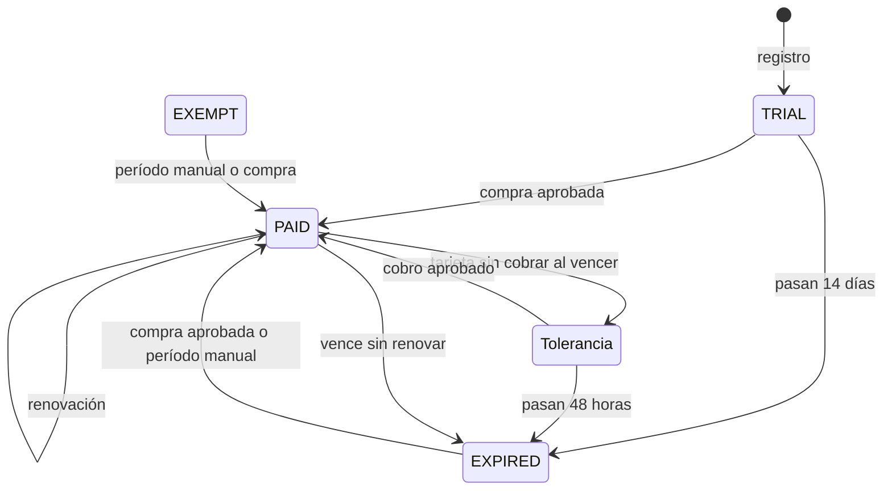
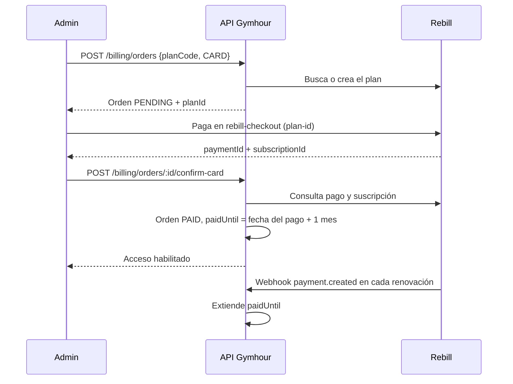
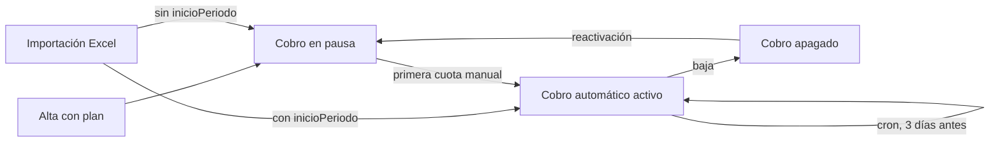

# Gymhour multi-tenant: documentación base

Foto del código en `master`, commit `b08ef61` (16 de noviembre de 2026), que ya incluye las tandas de arreglos del 2 y del 11 de noviembre, con sus migraciones aplicadas en producción. Suma los cobros a socios con Mercado Pago de la rama `feature-mercadopago` (19 de noviembre), todavía sin commit ni migraciones aplicadas: ver la [sección 19](#19-cobros-a-socios-con-mercado-pago).

Este documento se armó leyendo el código y corriendo tests con Prisma simulado. Si el código y este documento difieren, manda el código. Actualizalo en el mismo PR que cambie alguna de estas reglas.

## Índice

1. [Resumen](#1-resumen)
2. [Arquitectura](#2-arquitectura)
3. [Aislamiento entre gimnasios](#3-aislamiento-entre-gimnasios)
4. [Alta de un gimnasio](#4-alta-de-un-gimnasio)
5. [Prueba gratuita y estados de suscripción](#5-prueba-gratuita-y-estados-de-suscripción)
6. [Planes de Gymhour](#6-planes-de-gymhour)
7. [Integración con Rebill](#7-integración-con-rebill)
8. [Backoffice](#8-backoffice)
9. [Cuotas de los socios](#9-cuotas-de-los-socios)
10. [Validaciones de ingreso y reservas](#10-validaciones-de-ingreso-y-reservas)
11. [Tareas programadas](#11-tareas-programadas)
12. [Endpoints nuevos, modificados y eliminados](#12-endpoints-nuevos-modificados-y-eliminados)
13. [Variables de entorno](#13-variables-de-entorno)
14. [Migraciones](#14-migraciones)
15. [Entorno local y tests](#15-entorno-local-y-tests)
16. [Puntos de atención](#16-puntos-de-atención)
17. [Documentación y código desactualizados](#17-documentación-y-código-desactualizados)
18. [Reglas que no hay que romper](#18-reglas-que-no-hay-que-romper)
19. [Cobros a socios con Mercado Pago](#19-cobros-a-socios-con-mercado-pago)

## 1. Resumen

| Tema | Cómo funciona hoy |
|------|-------------------|
| Multi-tenant | Cada gimnasio es un `Tenant`. El cliente Prisma agrega `tenantId` a cada consulta según el contexto de la request. |
| Prueba gratuita | 14 días desde el registro. Durante la prueba están todas las funciones y no hay tope de socios. |
| Al vencer | Toda la API queda bloqueada con `403 SUBSCRIPTION_REQUIRED`, salvo `GET /auth/me` y `/billing/*` para administradores. |
| Planes | Esencial ($49.999, hasta 100 socios activos), Pro ($99.999, hasta 200) y A medida (más de 200, por contacto comercial). Solo mensuales. |
| Cobro a gimnasios | Rebill. Tarjeta con renovación automática o transferencia con renovación manual. |
| Fallo de cobro con tarjeta | 48 horas de tolerancia con acceso completo. Después, el admin cambia la tarjeta o paga por otra vía. |
| Cancelación | El admin o el backoffice cancelan el débito, y el acceso sigue hasta `paidUntil`. Eliminar un gimnasio también la cancela, y suspenderlo la pausa. |
| Cambio de plan | Subir a Pro se cobra proporcional y aplica en el momento. Bajar a Esencial se programa para el próximo vencimiento. |
| Backoffice | App separada con identidad propia, contraseña + TOTP, auditoría, período pago manual, cancelación de suscripciones, suspensión y eliminación de gimnasios. |
| Cuotas de socios | Ciclo individual por socio. La primera cuota es manual o viene del Excel y, desde ahí, el cron crea cada una tres días antes de que empiece. La generación masiva mensual ya no existe. |
| Vencimiento de cuota | El pago vence el primer día del período cubierto, salvo que el admin elija otra fecha al crear la cuota a mano. El socio entra y reserva hasta ese vencimiento, aunque no haya pagado. |

## 2. Arquitectura

```text
gymhour-multitenant/
├── gymhour-backend/    API Node.js, Express, TypeScript, Prisma 5, MySQL
│   ├── prisma/         Esquema, migraciones, seed y scripts manuales
│   ├── scripts/        platformAdmin, cuentas de prueba, auditoría de aislamiento
│   ├── src/controllers Lógica por dominio
│   ├── src/routes      Rutas y middlewares
│   ├── src/services    Billing, Rebill, ciclo de cuotas, reglas de acceso, cron
│   └── test/           Vitest
└── gymhour-frontend/   React 18 (Create React App)
    └── src/platform/   Backoffice, se compila aparte
```

- **Dos builds del frontend** con el mismo código: la app de gimnasios y el backoffice. `src/index.js` decide cuál renderizar según `REACT_APP_APP_MODE=platform`.
- **Despliegue en Railway**: la API y MySQL son servicios separados del mismo repo; el frontend corre en Vercel. Railway no tiene pre-deploy: las migraciones se aplican a mano con `prisma migrate deploy` contra la base de producción, justo antes de mergear.
- **Cron**: `src/scripts/dailyCron.ts` es el entrypoint pensado para un servicio de cron de Railway. También existen los endpoints `/cron/*`.

## 3. Aislamiento entre gimnasios

**Clientes Prisma**, en `src/models/Prisma.ts`:

- `prisma` (por defecto): lee el contexto de la request y agrega `tenantId` a filtros y escrituras. Sin contexto, falla con `TENANT_CONTEXT_REQUIRED`. Una escritura con otro `tenantId` falla con `CROSS_TENANT_WRITE_REJECTED`.
- `systemPrisma`: no filtra. Se usa en autenticación, billing, backoffice y jobs, siempre con `tenantId` explícito.

**Contexto de request**, en `src/services/tenantContext.service.ts`, con `AsyncLocalStorage`. Lo abren:

| Origen | Quién lo abre |
|--------|---------------|
| `JWT` | `authenticateToken` |
| `KIOSK` | `authenticateKiosk` y `authenticatePublicTenant` |
| `JOB` | `dispatchToActiveTenants` en cada iteración del cron |

**Subida de archivos.** Los eventos de Multer pueden ejecutarse fuera del contexto. Por eso `src/services/multer.service.ts` envuelve `upload.single` con `preserveTenantContext`. Cualquier forma nueva de subida tiene que pasar por ese envoltorio.

**Modelos globales.** `TenantBillingOrder` está en `TENANT_MODELS`. `TenantPlanChange`, `RebillWebhookEvent` y `RebillProcessedPayment` no lo están, y todo el código de billing usa `systemPrisma`.

**Cobros a socios con Mercado Pago.** `MercadoPagoAccount`, `CuotaPago` y `DebitoAutomatico` están en `TENANT_MODELS`, pero sus servicios usan `systemPrisma` con `tenantId` explícito, porque los avisos de Mercado Pago llegan sin sesión. `MercadoPagoOAuthState` y `MercadoPagoPendingNotification` son globales. Ver la [sección 19](#19-cobros-a-socios-con-mercado-pago).

**Login.** `POST /auth/login` recibe email y contraseña. Si coinciden en varios gimnasios, devuelve un token de selección de 5 minutos, y `POST /auth/login/select-tenant` emite el JWT definitivo. El JWT dura 1 hora y cada request vuelve a validar usuario, `authVersion` y tenant.

**Archivos.** Se guardan en `tenants/{tenantId}/...` con entrega autenticada y URL firmada por el backend. Los assets anteriores, fuera de ese prefijo, se siguen sirviendo como públicos.

## 4. Alta de un gimnasio

```text
/sign-up  →  POST /auth/tenants  →  sesión iniciada  →  /onboarding (2 pasos)  →  /admin/inicio
                     │
                     └→ mail de verificación (opcional, enlace válido 24 h)
```

**`POST /auth/tenants`** solo pide email y contraseña (mínimo 8 caracteres) y crea en una transacción:

- `Tenant` con nombre `Mi gimnasio`, slug temporal `nuevo-gimnasio-xxxx`, `trialEndsAt = ahora + 14 días` y `billingExempt = false`.
- `TenantSettings` con `onboardingCompleted = false`.
- Credencial de kiosco.
- `User` con rol `ADMIN` y `emailVerifiedAt = null`.

**Onboarding.** `ProtectedRoute` obliga a un admin sin onboarding a completarlo. `PUT /tenant/onboarding` exige nombre y apellido, nombre del gimnasio, celular, logo PNG/JPG/WebP, color, titular de la cuenta y alias o CBU. Ahí se define el slug real.

**Verificación de email: no bloquea.** El registro ya devuelve un JWT válido y el login funciona sin verificar; un test de integración lo exige así. El enlace abre `/verify-email`, marca `emailVerifiedAt`, envía el mail de bienvenida y lleva al onboarding. Los usuarios creados por otras vías quedan verificados por el default del campo.

## 5. Prueba gratuita y estados de suscripción

El estado se calcula en cada request en `getBillingAccess` (`src/services/billing.service.ts`), con esta prioridad:

| Prioridad | Estado | Condición |
|-----------|--------|-----------|
| 1 | `EXEMPT` | `billingExempt = true` |
| 2 | `PAID` | `paidUntil > ahora`, o tolerancia vigente (`billingGraceUntil > ahora`, sin prueba activa) |
| 3 | `TRIAL` | `trialEndsAt > ahora` |
| 4 | `EXPIRED` | Cualquier otro caso, incluso sin fechas cargadas |

`getBillingAccess` también devuelve `inGrace` y `graceUntil`. `inGrace` es `true` solo cuando el acceso se sostiene por la tolerancia.



- **Gimnasios anteriores al trial:** la migración `20261017000100` los dejó con `billingExempt = true`. Es el estado "Acceso conservado" del backoffice. Pasan a tener vencimiento en cuanto se les registra un pago.
- **Una prueba por email:** si el email ya es `ADMIN` de otro gimnasio, el nuevo se crea con `trialEndsAt` igual al momento del alta, es decir, sin prueba. `POST /auth/tenants` responde `trialAvailable`, y la pantalla de alta lo avisa antes de entrar.
- **Compra durante la prueba:** el período pago empieza al aprobarse el pago y no suma los días que quedaban. Hasta que termina la prueba siguen todas las funciones habilitadas.
- **Límite exacto:** al llegar justo a `trialEndsAt` o `paidUntil` el acceso ya está vencido. Lo mismo vale para `billingGraceUntil`.
- **Tolerancia:** solo existe con tarjeta. Se define como `paidUntil + 48 horas` en cada pago aprobado, y se borra si la suscripción pasa a `paused`, `cancelled` o `finished`. Ver [Tarjeta rechazada](#tarjeta-rechazada).

### Qué se bloquea en `EXPIRED`

| Caso | Resultado |
|------|-----------|
| Login | Permitido |
| `GET /auth/me` | Permitido; así el frontend conoce el estado |
| `/billing/*` como `ADMIN` | Permitido, para poder pagar |
| Cualquier otra ruta con JWT, cualquier rol | `403 SUBSCRIPTION_REQUIRED` |
| Kiosco y check-in público | `403 SUBSCRIPTION_REQUIRED` |
| Cron del gimnasio | Se saltea: no genera cuotas ni envía mails |
| Webhook de Rebill | Siempre se procesa |

`SUSPENDED` es independiente y tiene prioridad: el gimnasio responde `403` aunque tenga el pago al día, el login no lo encuentra y sus JWT quedan invalidados.

### Frontend

- `App.js` deja el contenido inerte y muestra `SubscriptionExpired` encima. El admin ve los planes; los demás roles ven "Tu acceso está en pausa".
- `AuthContext` refresca `/auth/me` cada 60 segundos, al recuperar el foco, al recibir `SUBSCRIPTION_REQUIRED` y justo al llegar a `trialEndsAt` o `paidUntil`.
- `TrialStatusBar` muestra los días restantes de prueba, a todos los roles.
- `SubscriptionRenewalStatusBar` avisa al admin cuando faltan 3 días o menos y no paga con tarjeta.
- `PaymentIssueStatusBar` avisa al admin durante la tolerancia, con un enlace a Mi suscripción.
- `TrialStatusBar` le avisa al admin, durante la prueba, si tiene más de 200 socios activos: al terminar va a necesitar el plan A medida. `GET /auth/me` suma `billing.activeStudents` solo en ese caso.
- El admin llega a los planes en cualquier momento desde **Mi suscripción** (`/admin/suscripcion`).

## 6. Planes de Gymhour

Definidos en `src/services/billingCatalog.service.ts`:

| Plan | Código | Precio mensual | Socios activos |
|------|--------|----------------|----------------|
| Esencial | `ESSENTIAL_MONTHLY` | $49.999 | Hasta 100 |
| Pro | `PRO_MONTHLY` | $99.999 | Hasta 200 |
| A medida | Sin código | A consultar | Más de 200, por WhatsApp |

Los códigos `UP_TO_100/300/1000_*` son el catálogo anterior (`LEGACY`). No se venden, y se conservan para verificar renovaciones de suscripciones ya creadas.

"Socio activo" significa `role = STUDENT` y `estado = true`. El catálogo ofrece solo los planes donde entra la cantidad actual: con 150 socios, solo Pro; con más de 200, solo A medida.

### Funciones por plan

Son cinco y `hasPaidFeature` las trata igual:

| Función | Endpoints protegidos | Pantalla bloqueada |
|---------|----------------------|--------------------|
| `CHECK_IN` | `POST /usuarios/asistencias/registrar`, `/kiosk/registrar`, `/public/:slug/registrar` | `/admin/ingreso` |
| `ATTENDANCE` | `GET /usuarios/asistencias/mis-asistencias`, `/historial` | `/admin/asistencias`, `/alumno/mis-asistencias` |
| `CHURN` | `GET /admin/churn-risk`, `POST /admin/churn-risk/contact` | `/admin/predictor-bajas` |
| `AI` | Todo `/ai/*` | `/admin/asistente-ia`, `/entrenador/asistente-ia` |
| `MEMBER_PAYMENTS` | `POST /pagos/mercadopago/conectar`, `/pagos/cuotas/:id/checkout`, `/pagos/debito` | Sección "Cobros con Mercado Pago" de Ajustes y botón de pago del socio |

`MEMBER_PAYMENTS` no frena los avisos de Mercado Pago: un pago cobrado se registra aunque el gimnasio haya bajado de plan o esté bloqueado.

| Situación | Funciones |
|-----------|-----------|
| `EXEMPT` | Todas |
| Dentro de los 14 días de prueba, haya comprado o no | Todas |
| `PAID` con Pro | Todas |
| `PAID` con catálogo anterior, o período manual sin ninguna orden pagada | Todas (`LEGACY`) |
| `PAID` con Esencial, ya sin prueba | Ninguna de las cuatro |
| `EXPIRED` | Ninguna |

El backend responde `403 PLAN_UPGRADE_REQUIRED` y el frontend muestra `PlanFeatureGate`. El control real es el del backend. El asistente de IA tiene además un tope de 100 consultas por usuario por mes.

### Tope de socios

`requireStudentCapacity` (`src/services/studentCapacity.service.ts`) corre en `POST /usuarios`, `POST /usuarios/import`, `PUT /usuarios/:id` y `PUT /usuarios/estado/:id`, y solo actúa si la operación suma socios activos.

| Situación | Tope |
|-----------|------|
| Exento o dentro de la prueba | Sin tope |
| Esencial, o baja a Esencial programada (aunque siga en Pro) | 100 |
| Pro | 200 |
| `LEGACY` | Sin tope |

Al superarlo responde `409 PLAN_STUDENT_LIMIT`. No da de baja ni bloquea a los socios que ya estaban.

## 7. Integración con Rebill

Código en `src/services/rebill.service.ts`, `src/services/tenantSubscription.service.ts`, `src/controllers/billing.Controller.ts`, `src/controllers/billingChange.Controller.ts`, `src/controllers/billingSubscription.Controller.ts` y, en el frontend, `Components/SubscriptionExpired/SubscriptionExpired.jsx`, que usa el componente `<rebill-checkout>` del paquete `rebill`.

### Modelos

| Modelo | Para qué |
|--------|----------|
| `TenantBillingOrder` | Compra de un plan. `status`: `PENDING`, `PAID`, `REJECTED`. La orden pagada más reciente define el plan vigente, y las renovaciones actualizan esa misma fila. También guarda `cancelledAt`, `cancelReason` y `pausedBySuspensionAt`. |
| `TenantPlanChange` | Cambio de plan dentro de un período. `status`: `PENDING`, `PAYMENT_CONFIRMED`, `APPLIED`, `FAILED`. Uno por orden y período. |
| `RebillWebhookEvent` | Idempotencia por `logId` del webhook. |
| `RebillProcessedPayment` | Evita acreditar dos veces el mismo pago. |
| `Tenant.paidUntil`, `billingGraceUntil`, `billingCreditArs` | Vencimiento del acceso, fin de la tolerancia y saldo a favor. |

Los planes se buscan en Rebill por nombre y se crean si faltan (`findOrCreateRebillPlan`); no hay IDs configurados. Los importes son pesos enteros.

### Compra con tarjeta



`POST /billing/orders` rechaza si el plan no corresponde a la cantidad de socios, si ya está en `PAID` sin tolerancia, si hay saldo a favor (solo tarjeta) o si hay una baja programada a otro plan. Si existe una suscripción que no figura `cancelled` ni `finished`, responde `409 SUBSCRIPTION_RECOVERY_REQUIRED`, salvo que llegue `replaceSubscription: true`. Ver [Tarjeta rechazada](#tarjeta-rechazada).

`confirm-card` solo habilita si Rebill confirma todo esto:

- Pago `approved`, por el importe de la orden, en ARS, posterior a la creación de la orden.
- El email del comprador es el del admin logueado.
- La suscripción coincide en importe, frecuencia y nombre del plan, sin repeticiones limitadas.

### Compra por transferencia

1. `POST /billing/orders` con `TRANSFER`. Si hay saldo a favor, se descuenta del importe.
2. `<rebill-checkout>` muestra el pago único, con `metadata.gymhourOrderId`.
3. Rebill avisa al navegador cuando genera el QR (`status: pending_customer_charge`), antes de que exista el pago y sin su ID. El modal deja el QR visible y muestra "Ya transferí, verificar ahora".
4. `POST /billing/orders/:id/confirm-transfer` se llama sin `paymentId`, con el botón o cada 15 segundos durante 10 minutos. Estas verificaciones tienen su propio límite de pedidos (120 cada 15 minutos), aparte del general de `/billing` (30). El backend busca el pago en Rebill (`POST /v3/payments/search` con el email del admin) y lo identifica por `metadata.gymhourOrderId`. Si todavía no existe, responde `202`. Si existe sin acreditar, responde `202` y guarda el `paymentId`.
5. El webhook también acredita, aunque el navegador esté cerrado.
6. No hay renovación: al vencer vuelve a aparecer el modal.

Al confirmarse una compra, con tarjeta o transferencia, el modal muestra "Pago confirmado" con la fecha de vencimiento del acceso, y se cierra recién con "Ir a Gymhour". El comprobante lo envía Rebill por email.

### Webhook

`POST /billing/webhooks/rebill`, con firma HMAC-SHA256 sobre el body crudo en `x-rebill-signature`. Sin `REBILL_SIGNING_SECRET`, responde siempre `401`.

| Evento | Condición | Efecto |
|--------|-----------|--------|
| Cualquiera | `logId` ya procesado | `204` sin cambios |
| `subscription.updated` | Con `cardUpdated: true` | Si el gimnasio está `ACTIVE` con `paidUntil` vencido, intenta cobrar enseguida. No toca el estado guardado. Si falla, responde `500` y Rebill reintenta. |
| `subscription.updated` | Resto | Guarda `rebillSubscriptionStatus` en la orden. En `paused`, `cancelled` o `finished` borra la tolerancia. Si pasa a `paused` por falta de pago, avisa por mail. |
| `payment.created` o `payment.updated`, sin suscripción | Aprobado, con `gymhourPlanChangeId` | Confirma y aplica el cambio de plan |
| `payment.created` o `payment.updated`, sin suscripción | Aprobado, con `gymhourOrderId`, de una transferencia pendiente y email de un admin | Acredita la orden |
| `payment.created`, con suscripción | Orden `PAID`, pago aprobado y distinto del primero | Renovación: `paidUntil` = mayor entre `paidUntil` y fecha del pago, más un período, y `billingGraceUntil` = `paidUntil` + 48 horas. Si había una baja programada, la orden pasa a Esencial. Avisa por mail. |
| `payment.created`, con suscripción | Pago rechazado | Se registra y responde `204`. Rebill reintenta con un pago nuevo. Avisa por mail una vez por período (`failureNotifiedUntil`). |
| `payment.created`, con suscripción | Ninguna orden tiene esa suscripción | Si el pago está aprobado, lo guarda en `RebillUnlinkedPayment` para vincularlo desde el backoffice. Si Rebill no responde, `500` y reintenta. |
| `payment.created`, con suscripción | Aprobado, con datos que no coinciden | `409`, para que Rebill reintente |
| Resto | | Se registra y responde `204` |

Rebill reintenta el webhook a los 5 minutos, a la hora y al día si hay un 5xx, una demora de más de 9 segundos o una falla de red.

### Tarjeta rechazada

Rebill reintenta el cobro 4 veces en 10 días (`retrying`) y, si no lo logra, pausa la suscripción (`paused`). Gymhour le da 48 horas de acceso desde `paidUntil` y después bloquea, aunque Rebill siga reintentando. Si un reintento se aprueba, el webhook extiende el acceso.

Mientras haya una suscripción sin terminar y el acceso esté vencido o en tolerancia, Mi suscripción ofrece dos salidas:

| Salida | Qué hace |
|--------|----------|
| **Cambiar tarjeta** | `POST /billing/subscription/card-update-link` devuelve la página segura de Rebill. Al llegar el webhook con `cardUpdated`, si el acceso está vencido: de `active` adelanta `nextChargeDate` a hoy; de `paused` reactiva con esa fecha; de `retrying` pasa por `paused` y luego reactiva. |
| **Pagar de otra forma** | Avisa que se cancelará la anterior y envía `replaceSubscription: true` en `POST /billing/orders`. La cancelación ocurre antes de crear la orden. Si Rebill falla, responde `503` y no crea nada. |

**A confirmar en sandbox:** el cobro inmediato al cambiar la tarjeta. Según la documentación de Rebill, la tarjeta nueva por sí sola no adelanta el cobro.

### Cancelación

`cancelTenantSubscriptions` consulta primero el estado en Rebill, cancela si hace falta y guarda `cancelledAt`, `cancelReason` y `cancelledBy` (el email del admin, `Backoffice · <operador>` o `Backoffice · eliminación`). También borra la tolerancia. El acceso sigue hasta `paidUntil`, y cancelar en Rebill es definitivo.

| Origen | Cómo |
|--------|------|
| Admin | Botón en Mi suscripción, con motivo. `POST /billing/subscription/cancel`. Responde `409` si no hay suscripción y `503` si falla Rebill. Avisa por mail. |
| Backoffice | `POST /platform/tenants/:id/subscription/cancel`, con motivo, MFA y auditoría. Responde `502` si falla Rebill. Avisa por mail. |
| Eliminar gimnasio | `purgeTenant` cancela antes de borrar. Si Rebill falla, responde `502` y no elimina nada. |
| Compra de reemplazo | "Pagar de otra forma", con el motivo `Reemplazada por una nueva compra`. |

### Suspensión

`changeTenantStatus` habla con Rebill antes de cambiar el estado. Si Rebill falla, responde `502` y el gimnasio queda como estaba.

- **Al suspender:** pausa las suscripciones `active` o `retrying` y marca `pausedBySuspensionAt`. Una que ya estaba `paused` por falta de pago no se marca.
- **Al reactivar:** retoma solo las marcadas, con `nextChargeDate` = mayor entre ahora y `paidUntil`, y `billingGraceUntil` = esa fecha + 48 horas.

### Pagos con tarjeta sin vincular

El vínculo con la suscripción se crea en `confirm-card`, que depende del navegador. Si no se completa, el webhook del primer pago no encuentra la orden y lo guarda en `RebillUnlinkedPayment`. Si el webhook llega antes que la confirmación y esta se completa después, `activateCardOrder` lo marca como vinculado.

- **Backoffice:** el dashboard avisa cuántos hay, y la página "Pagos sin vincular" lista uno por suscripción. La sugerencia es una orden `CARD PENDING` del mismo importe, creada antes del pago, de un gimnasio donde el email del pago es `ADMIN`. Si no hay sugerencia, el operador busca el gimnasio.
- **Vincular:** `POST /platform/billing/unlinked-payments/:id/link` con la orden, motivo y MFA. Valida contra Rebill con `cardPaymentMatchesOrder` (todo lo de `confirm-card` menos el email) y activa con `activateCardOrder`. Si la suscripción ya tenía renovaciones sin acreditar, las acredita en orden. Audita `TENANT_PAYMENT_LINK` y avisa por mail.
- **Admin:** si su última orden es de tarjeta, está pendiente y tiene menos de 24 horas, el modal avisa "¿Ya pagaste con tarjeta?" antes de que pague de nuevo.

Hasta que se vincula, cancelar, suspender y eliminar no alcanzan a esa suscripción.

### Mails al administrador

`billingNotifications.service.ts` les escribe a los `ADMIN` activos del gimnasio, sin bloquear la respuesta: un mail que falla solo queda en el log.

| Mail | Cuándo |
|------|--------|
| Compra confirmada | `confirm-card`, `confirm-transfer`, transferencia acreditada por webhook o vínculo manual, solo cuando la orden cambió de estado |
| Renovación cobrada | Renovación aprobada por webhook |
| Cobro fallido | Primera renovación rechazada del período |
| Suscripción en pausa | `subscription.updated` a `paused` que no viene de una suspensión |
| Cancelación | Desde Mi suscripción o el backoffice. No al reemplazar la compra ni al eliminar el gimnasio. |

### Subir a Pro

1. `GET /billing/plan-change/quote` calcula `(99.999 − 49.999) × tiempo restante del período`, con un mínimo de $1.
2. `POST /billing/plan-change` recibe el `expectedAmountArs`. Si cambió, responde `409` para que el admin revise el nuevo importe.
3. El admin paga el ajuste con `<rebill-checkout>`, con `metadata.gymhourPlanChangeId`.
4. `POST /billing/plan-change/:id/confirm`, o el webhook, verifica el pago y aplica el cambio: en tarjeta cambia el plan de la suscripción en Rebill, y la orden pasa a Pro. Con transferencia, el navegador no recibe el ID del pago: igual que en la compra, el modal muestra "Ya transferí, verificar ahora", consulta cada 15 segundos durante 10 minutos, y el backend busca el pago por `metadata.gymhourPlanChangeId`.

`paidUntil` no se mueve y Pro aplica de inmediato. Solo se admite un cambio por período, y no aplica a planes del catálogo anterior.

### Bajar a Esencial

1. Exige 100 socios activos o menos. Sin cargo ni devolución.
2. En tarjeta, cambia ya el plan de la suscripción en Rebill para que la próxima renovación cobre Esencial.
3. El `TenantPlanChange` queda `APPLIED` con importe 0 y el plan efectivo sigue siendo Pro hasta `periodEnd`. El tope de 100 socios aplica desde el momento en que se programa.
4. En la renovación por webhook, la orden pasa a Esencial. En transferencia, la próxima orden solo se puede crear por Esencial.
5. `POST /billing/plan-change/cancel-scheduled` la revierte. Con tarjeta no se permite a menos de 15 minutos de la renovación.

`rebillRefundId` guarda además los estados `CANCELLING_DOWNGRADE` y `CANCELLED_DOWNGRADE` de la cancelación (con `status = FAILED`). No son reembolsos.

## 8. Backoffice

App en `gymhour-frontend/src/platform/` y API en `/platform/*`. La identidad (`PlatformUser`, rol `SUPER_ADMIN`) es global y no sirve en las rutas de gimnasios.

### Seguridad

| Capa | Regla |
|------|-------|
| Contraseña | Argon2id, de 16 a 128 caracteres. Bloqueo de 15 minutos tras 5 fallos. |
| Segundo factor | TOTP obligatorio, sin reutilización del mismo código, o uno de los 10 códigos de recuperación. El secreto se guarda cifrado con `PLATFORM_MFA_ENCRYPTION_KEY`. |
| Sesión | Cookie `httpOnly`, `SameSite=Strict`, limitada a `/platform`. Vence a los 15 minutos sin uso o a las 8 horas. |
| Mutaciones | Token CSRF y verificación de origen contra `PLATFORM_FRONTEND_URL`. |
| Rate limit | 5 intentos de contraseña cada 15 minutos, 10 de MFA cada 5. |
| Auditoría | `PlatformAuditLog`: logins, logout, período pago, cancelación de suscripción, vínculo de pagos, suspensión, reactivación y eliminación, con IP y user agent. |

### Funciones

| Pantalla | Qué permite | Confirmación |
|----------|-------------|--------------|
| Dashboard | Totales de gimnasios, activos, suspendidos, altas de 30 días y evolución de 12 meses | |
| Tenants | Búsqueda por nombre, slug o email; filtro por estado; estado de suscripción | |
| Detalle | Contacto, administradores, fin de prueba, acceso pago hasta, débito automático, últimas 30 órdenes con el estado de su suscripción | |
| Registrar período pago | Define `paidUntil`, que debe ser futuro y posterior al actual. Pasa `billingExempt` a `false`. | Motivo y MFA |
| Cancelar suscripción | Corta el débito en Rebill. El acceso sigue hasta `paidUntil`. | Motivo y MFA |
| Pagos sin vincular | Vincula a una orden pendiente un primer pago con tarjeta que llegó sin confirmar. Ver [Pagos con tarjeta sin vincular](#pagos-con-tarjeta-sin-vincular). | Motivo y MFA |
| Suspender o reactivar | Corta el acceso e invalida los JWT de todos los usuarios. Pausa el débito, y la reactivación lo retoma. | Motivo y MFA |
| Eliminar | Cancela la suscripción, borra los datos en una transacción y limpia Cloudinary con un job reintentable | Slug, contraseña, MFA y motivo |
| Auditoría | Consulta con filtros por tenant, acción y resultado | |

### Cuentas

```bash
npm run platform-admin -- create --email correo@dominio.com
npm run platform-admin -- reset-password --email correo@dominio.com
npm run platform-admin -- reset-mfa --email correo@dominio.com
```

`create` hoy solo admite **una** cuenta en toda la plataforma (`scripts/platformAdmin.mjs`), aunque el backend soportaría varias. `reset-*` revoca las sesiones de esa cuenta y, sin `--email`, actúa sobre la primera que encuentra.

### Qué no se puede hacer desde el backoffice

Extender una prueba, marcar un gimnasio como exento, elegir el plan de un período manual, ver o gestionar cambios de plan, filtrar por estado de suscripción o ver métricas de ingresos.

## 9. Cuotas de los socios

### Qué cambió

Antes el admin generaba todas las cuotas del mes de una vez. Ahora **cada socio tiene su propio ciclo**, con su propia fecha de inicio. Los endpoints masivos se eliminaron y la pantalla Cuotas se reescribió.

| Antes | Ahora |
|-------|-------|
| Botón "Generar cuotas de este mes" | Una por socio: "Crear próxima cuota", y el cron |
| Período alineado al mes calendario | Período desde el día de alta, según la duración del plan |
| `vence` dentro del mes | `vence` es el primer día del período, por defecto |
| Filtro y reportes por `mes` | Filtro por mes de `vence`; ingresos por `fechaPago` |
| Duraciones fijas | `WEEKS:n` (1 a 52) o `MONTHS:n` (1 a 24), más los nombres anteriores |

### Campos nuevos

| Modelo | Campo | Significado |
|--------|-------|-------------|
| `User` | `fechaInicioCobro` | Inicio del ciclo |
| `User` | `proximoInicioCuota` | Inicio de la próxima cuota a crear |
| `User` | `diaAnclaCobro` | Día del mes que se intenta conservar |
| `User` | `cobroAutomaticoActivo` | Si el cron le genera cuotas |
| `Cuota` | `recordatorioVenceEnviado` | Evita repetir el mail de vencimiento |
| `Cuota` | `origen` | `MANUAL`, `MASIVA` (histórico), `AUTOMATICA` o `IMPORTACION` |

Índice único nuevo en `Cuota`: `(tenantId, ID_Usuario, fechaInicio)`.

### Cálculo de fechas

En `src/services/feeDates.service.ts`, en wall-clock UTC:

- **Fin del período:** un milisegundo antes del inicio siguiente. Del 17/10 con plan mensual, cubre hasta el 16/11.
- **Día ancla:** si el mes es más corto se ajusta al último día y luego vuelve. 31/01 → 28/02 → 31/03.
- **Vencimiento automático:** el primer día del período a las 23:59:59.999.
- **`mes`:** el mes en que empieza el período. Ya no define la cobertura.
- **"Hoy":** usa la zona horaria del gimnasio (`TenantSettings.timezone`).

### Ciclo de vida



| Evento | Efecto en el socio |
|--------|--------------------|
| Alta individual con plan | `fechaInicioCobro` y `proximoInicioCuota` = hoy, cobro automático apagado. El frontend ofrece crear la primera cuota; "Ahora no" lo deja en pausa. |
| Importación por Excel | Depende de la fila. Ver [Importación por Excel](#importación-por-excel). |
| Primera cuota manual | Activa el cobro. `fechaInicioCobro` = inicio del período y `proximoInicioCuota` = día siguiente al fin. |
| Cuota manual siguiente | Mueve `proximoInicioCuota`. Si se eligió un inicio posterior al sugerido, el día ancla pasa a ser ese día. |
| Asignar plan a quien no tenía plan o fecha de inicio | Fecha de inicio = hoy, cobro apagado. |
| Cambiar de plan con ciclo en curso | La próxima cuota usa el precio y la duración del plan nuevo. |
| Quitar plan o dar de baja | Apaga el cobro. |
| Reactivar con plan | Inicio = hoy, o el día siguiente a la última cuota si sigue vigente. Cobro apagado hasta la próxima cuota manual. |
| Eliminar una cuota | El cursor no retrocede: el cron no la vuelve a crear, y `preview` sigue ofreciendo recrearla a mano. Si era la única del socio, vuelve al estado de alta: fechas = hoy y cobro apagado. |

### Importación por Excel

`POST /usuarios/import` acepta dos columnas opcionales, `inicioPeriodo` (DD/MM/AAAA) y `cuotaPaga` (SI/NO). Sigue siendo todo o nada: un error en una fila no importa a nadie.

| Fila | Resultado |
|------|-----------|
| Sin plan | Sin ciclo. Con `inicioPeriodo` o `cuotaPaga = SI`, es error de esa fila. |
| Con plan, sin `inicioPeriodo` | Fechas = hoy y cobro apagado. La primera cuota se crea desde Cuotas. `cuotaPaga = SI` es error. |
| Con plan e `inicioPeriodo` | Crea la primera cuota (`origen = IMPORTACION`) y activa el cobro. |
| El período de `inicioPeriodo` ya terminó | Error de esa fila. Hay que indicar el inicio del período en curso. |
| `cuotaPaga = SI` | Cuota pagada, con fecha de pago = hoy y medio "Informado al importar". |
| `cuotaPaga` vacío o `NO` | Impaga. Queda vencida si el vencimiento ya pasó, y entonces bloquea al socio. |
| Plan gratuito | Pagada automáticamente. |

Usuarios y cuotas se crean en la misma transacción, y la respuesta suma `cuotasCreadas`.

Excel puede convertir una fecha escrita y, si está configurado mes/día, invertir día y mes (`05/10` queda como 10 de mayo). Por eso la plantilla trae `fechaCumple` e `inicioPeriodo` con formato texto en las filas 2 a 501, y la vista previa muestra las fechas con el mes en letras ("5 oct 2026"). Las filas totalmente vacías se ignoran.

### Creación manual

`GET /cuotas/usuario/:id/preview` sugiere los datos y `POST /cuotas/usuario/:id` crea la cuota. Reglas de `createCycleFee`, en transacción serializable:

- El socio debe ser `STUDENT`, estar activo y tener plan.
- `fechaInicioCobro` solo se acepta si todavía no tiene cuotas ni cobro activo. Si es pasada, avanza hasta el próximo aniversario: no se generan períodos pasados de una alta nueva.
- El inicio no puede ser anterior al sugerido. Puede ser posterior, y eso deja un hueco sin cobertura.
- El fin debe coincidir exactamente con el que da la duración del plan.
- `vence` debe estar dentro del período.
- No puede solaparse con otra cuota, incluidas las viejas sin fechas del mismo mes.
- Con `pagada = true`, exige medio de pago y fecha no posterior a hoy.
- Si el plan es gratuito, el importe debe ser 0 y queda pagada automáticamente.
- Copia el snapshot del plan y genera los turnos fijos del período.

### Generación automática

`generateDueFees` (`src/services/feeCycle.service.ts`) corre en el cron por cada gimnasio habilitado:

- Toma socios `STUDENT` activos, con plan, cobro activo y `proximoInicioCuota <= hoy + 3 días`.
- Usa el plan **actual**, con vencimiento el primer día y origen `AUTOMATICA`.
- Si hay períodos atrasados, por ejemplo tras un bloqueo, **saltea los que ya terminaron** (`skipEndedPeriods`) y crea solo el que cubre hoy. Si ese período empezó antes de hoy, queda marcado como vencido.
- Si la cuota ya existe con el mismo inicio, avanza el cursor. Si se solapa de otra forma, cuenta un error para ese socio y sigue con los demás.

### Pago, edición y eliminación

| Acción | Endpoint | Reglas |
|--------|----------|--------|
| Registrar pago | `PUT /cuotas/:id/pay` | Medio obligatorio y fecha no posterior a hoy. Si ya estaba pagada, `409`. Acepta `referenciaPago` (número de comprobante) y `aplicarRecargo`: el recargo lo calcula el servidor. |
| Editar | `PUT /cuotas/:id` | Solo el importe, mayor a 0, y solo si no está pagada. |
| Eliminar | `DELETE /cuotas/:id` | También borra sus turnos. Se permite aunque esté pagada. No vuelve a aparecer. |
| Regenerar turnos fijos | `POST /cuotas/usuario/:id/regenerate-turnos-fijos` | Sin cambios. |

Con un pago de Mercado Pago en curso para la cuota, o si la cuota está cubierta por un débito automático, registrar el pago, editar y eliminar responden `409`. Así no puede haber un cobro doble. Ver la [sección 19](#19-cobros-a-socios-con-mercado-pago).

### Recargo por atraso

Cada gimnasio lo configura en Ajustes (`TenantSettings.recargoTipo`, `recargoValor`, `recargoTope`, `recargoDiasGracia`): sin recargo, monto fijo, porcentaje único o porcentaje diario con tope, con días de gracia opcionales.

- Lo calcula `calculateLateFee` (`services/lateFee.service.ts`) para el día de pago.
- Las consultas de cuotas devuelven `recargoSugerido` en las impagas.
- `GET /cuotas/:id/recargo?fechaPago=` lo calcula para el pago manual.
- Al pagar, queda en `Cuota.recargo`.
- No aplica al débito automático.

### Reportes

Dashboard, asistente de IA e insights cuentan los ingresos por `fechaPago`, sumando `importe + recargo`, y lo pendiente por `vence`. El estado de un socio se calcula sobre la cuota que cubre hoy, no sobre la del mes. El alumno ve "Período cubierto" y "Vencimiento del pago".

## 10. Validaciones de ingreso y reservas

### Ingreso

Antes del controlador: credencial válida, suscripción no vencida y función `CHECK_IN` habilitada. Después, `registrarAsistencia`, en este orden:

| # | Validación | Resultado si falla |
|---|-----------|--------------------|
| 1 | Viene el DNI | `400` |
| 2 | Existe el DNI en este gimnasio | `404 DENEGADO_NO_EXISTE`, sin registrar asistencia |
| 3 | Usuario activo | `403 DENEGADO_INACTIVO` |
| 4 | Hay cuota activa y ninguna vencida e impaga | `403 DENEGADO_CUOTA` |
| 5 | Si el plan lo requiere: turno `ACTIVO` en ventana de ±20 minutos | `403 DENEGADO_SIN_TURNO` |
| 6 | No superó las sesiones totales del período | `403 DENEGADO_LIMITE_SEMANAL` (nombre histórico) |
| 7 | No ingresó ya hoy | `409 DENEGADO_DUPLICADO` |
| 8 | Registra `PERMITIDO` y pasa el turno a `ASISTIDO` | |

Una cuota cuenta como vencida si `vencida = true` **o** `vence < ahora`, sin esperar al cron. Cualquier cuota vencida e impaga bloquea, aunque sea de otro período. Una cuota impaga sin vencer deja entrar, y el mensaje lo indica: "La cuota está pendiente de pago". La cuota activa es la que cubre hoy: el respaldo por `mes` solo aplica a cuotas viejas sin fechas, así que una cuota futura no habilita el ingreso.

### Reservas

`createTurno`:

- **Para todos:** tiene que haber una cuota que cubra la fecha del turno. El respaldo por `mes` solo aplica a cuotas viejas sin fechas.
- **Todos menos `ADMIN`:** sin deuda vencida, sesiones disponibles, un turno por día y cupo libre. El admin no pasa por estas reglas.

### Sesiones de gracia

Se eliminaron: ya no existen `Plan.sesionesGracia` ni `Cuota.planSesionesGraciaSnapshot`. La regla es una sola: el socio entra y reserva hasta el vencimiento de la cuota.

## 11. Tareas programadas

`dailyCron.ts` corre una vez por día; su comentario indica 10:00 UTC (07:00 en Argentina). Recorre los gimnasios `ACTIVE` que no estén en `EXPIRED`, uno por vez. Primero corre el bloque nocturno y después los recordatorios.

| Bloque | Tarea | Detalle |
|--------|-------|---------|
| Nocturno | Generar cuotas | Ver [Generación automática](#generación-automática) |
| Nocturno | Marcar vencidas | Impagas con `vence` pasado |
| Nocturno | Turnos ausentes | `ACTIVO` pasados y sin asistencia |
| Nocturno | Cumpleaños | Mail del día |
| Nocturno | Conversaciones de IA | Borra las de más de 90 días sin actividad |
| Recordatorios | Turnos de hoy | Un mail por alumno |
| Recordatorios | Cuota por vencer | Vence en exactamente 3 días, una vez por cuota |
| Recordatorios | Inactividad | Última asistencia hace exactamente 15 días |

Después de los gimnasios, `dailyCron.ts` y `GET /cron/nightly` corren `runMercadoPagoMaintenance` para **todos** los gimnasios conectados a Mercado Pago, también los bloqueados:

1. Renueva tokens.
2. Resuelve pagos sin confirmar.
3. Cancela débitos sin autorizar después de 48 horas.
4. Procesa los avisos en cola.
5. Registra los cobros de débitos cuyo aviso se perdió.

Ver `gymhour-backend/MERCADOPAGO.md`.

`POST /cron/platform-maintenance` reintenta limpiezas de gimnasios eliminados y borra sesiones vencidas del backoffice. Todo `/cron/*` exige `Authorization: Bearer <CRON_SECRET>`.

## 12. Endpoints nuevos, modificados y eliminados

**Nuevos**

| Método y ruta | Quién | Para qué |
|---------------|-------|----------|
| `POST /auth/verify-email` | Público | Confirma el email y devuelve un JWT |
| `POST /auth/resend-verification` | Público | Reenvía el enlace |
| `GET /billing/catalog` | Admin | Planes, socios activos, estado y última orden |
| `POST /billing/orders` | Admin | Inicia una compra |
| `POST /billing/orders/:id/confirm-card` | Admin | Confirma el primer pago con tarjeta |
| `POST /billing/orders/:id/confirm-transfer` | Admin | Verifica una transferencia |
| `GET /billing/plan-change/quote` | Admin | Calcula el cambio de plan |
| `POST /billing/plan-change` | Admin | Crea el cambio o programa la baja |
| `POST /billing/plan-change/:id/confirm` | Admin | Confirma y aplica |
| `POST /billing/plan-change/cancel-scheduled` | Admin | Cancela la baja programada |
| `POST /billing/subscription/cancel` | Admin | Cancela el débito, con motivo |
| `POST /billing/subscription/card-update-link` | Admin | Devuelve la página de Rebill para cambiar la tarjeta |
| `POST /billing/webhooks/rebill` | Rebill, con firma | Eventos de pago y suscripción |
| `PATCH /platform/tenants/:id/billing` | Backoffice | Registra un período pago |
| `POST /platform/tenants/:id/subscription/cancel` | Backoffice | Cancela el débito, con motivo y MFA |
| `GET /platform/billing/unlinked-payments` | Backoffice | Pagos con tarjeta sin vincular, con sugerencias |
| `POST /platform/billing/unlinked-payments/:id/link` | Backoffice | Vincula el pago a una orden, con motivo y MFA |
| `GET /platform/tenants/:id/billing-orders` | Backoffice | Últimas 30 órdenes |
| `POST /usuarios/:id/welcome-email` | Admin | Envía la bienvenida a pedido |
| `GET /cuotas/:id/recargo` | Admin | Recargo sugerido para la fecha de pago |
| `/pagos/*` | Admin, socio, Mercado Pago | Cobros a socios con Mercado Pago. La lista completa está en `gymhour-backend/MERCADOPAGO.md`, "Endpoints". |

**Modificados**

| Ruta | Cambio |
|------|--------|
| `GET /auth/me` | Incluye `tenant.billing` con estado, plan y funciones. Responde también con la suscripción vencida. Al admin en prueba le suma `activeStudents`. |
| `POST /auth/tenants` | Solo pide email y contraseña, y dispara la verificación. Sin prueba si el email ya es admin de otro gimnasio; responde `trialAvailable`. |
| `POST /billing/plan-change/:id/confirm` | Sin `paymentId`, busca el pago de la transferencia en Rebill: `202` si todavía no está, `503` si Rebill no responde. |
| `POST /usuarios` | Exige nombre, apellido, email y contraseña; arranca el ciclo; valida el tope de socios. |
| `PUT /usuarios/:id`, `PUT /usuarios/estado/:id` | Validan el tope de socios y ajustan el ciclo de cobro. |
| `POST /usuarios/import` | Valida el tope de socios, acepta `inicioPeriodo` y `cuotaPaga`, y responde `cuotasCreadas`. |
| `POST /billing/orders` | Se permite durante la tolerancia. Acepta `replaceSubscription`, y puede responder `409 SUBSCRIPTION_RECOVERY_REQUIRED`. |
| `PATCH /platform/tenants/:id/status`, `POST /platform/tenants/:id/purge` | Pausan, retoman o cancelan la suscripción en Rebill. Si Rebill falla, responden `502` sin cambios. |
| `GET /cuotas/usuario/:id/preview`, `POST /cuotas/usuario/:id` | Pasan al ciclo individual. |
| `GET /cuotas` | `mes` filtra por mes de `vence` (`400` si es inválido), y se agrega `estado=vencida`. |
| `PUT /cuotas/:id/pay` | Acepta `fechaPago`, `referenciaPago` y `aplicarRecargo`. Responde `409` si ya estaba pagada, si hay un pago de Mercado Pago en curso o si la cuota la cubre un débito automático. |
| `PUT /cuotas/:id`, `DELETE /cuotas/:id` | `409` con un pago de Mercado Pago en curso o un débito automático. |
| `GET /cuotas`, `GET /cuotas/me`, `GET /cuotas/usuario/:id/cuotas` | Suman `recargo`, `referenciaPago`, `recargoSugerido`, `pagoEnLinea` y `cubiertaPorDebito`. |
| `PATCH /tenant/settings` | Acepta la configuración del recargo, validada. |
| `GET /usuarios` | Filtro `debito` y `debitoAutomatico` en cada socio. |
| `GET /usuarios/stats` | Suma `debitosAutomaticos`. |
| `PUT /usuarios/:id`, `PUT /usuarios/estado/:id`, `DELETE /usuarios/:id` | Al dar de baja o eliminar a un socio, cancelan su débito automático. Si Mercado Pago no lo confirma, responden `502` sin cambios. El cambio de plan ajusta o cancela el débito. |
| `PUT /planes/:id` | Un cambio de precio o duración ajusta o cancela los débitos de ese plan; responde `debitos`. |
| `POST /platform/tenants/:id/purge` | Cancela los débitos de los socios antes de eliminar. Si falla, `502`. |
| `GET /platform/tenants/:id` | Suma `mercadoPago` (estado de la conexión y débitos, sin tokens). |
| `POST`, `PUT /planes` | Aceptan `duracionUnidad` y `duracionCantidad`. |
| `/admin/churn-risk*`, `/ai/*`, `/usuarios/asistencias/*` | Exigen la función del plan. |

**Eliminados**

`POST /cuotas/generate-cuotas`, `/generate-cuotas/preparar`, `/generate-cuotas/lote`, `/delete-cuotas/preparar`, `/delete-cuotas/lote`, `/usuario/:id/preparar-lotes` y `/usuario/:id/turnos-fijos/lote`.

## 13. Variables de entorno

Solo las relacionadas con este documento. La lista completa está en `gymhour-backend/.env.example`.

| Variable | Dónde | Para qué | Si falta |
|----------|-------|----------|----------|
| `REBILL_PUBLIC_KEY` | Backend, se envía al checkout | Checkout | Los pagos no están disponibles (`503`) |
| `REBILL_SECRET_KEY` | Backend, nunca al frontend | API de Rebill | Los pagos no están disponibles (`503`) |
| `REBILL_SIGNING_SECRET` | Backend | Firma del webhook | **Todos los webhooks dan `401`: no se acreditan renovaciones ni transferencias con el navegador cerrado** |
| `REBILL_API_BASE_URL` | Backend | URL de la API | Usa `https://api.rebill.com` |
| `FRONTEND_URL` | Backend | CORS, enlaces de mails | La verificación de email no se envía |
| `PLATFORM_FRONTEND_URL` | Backend | CORS y origen del backoffice | El backoffice rechaza el origen |
| `PLATFORM_MFA_ENCRYPTION_KEY` | Backend | Cifra los secretos TOTP (32 bytes) | El login del backoffice falla |
| `CRON_SECRET` | Backend | Protege `/cron/*` | `500` en esos endpoints |
| `TIMEZONE` | Backend | Zona por defecto de los nuevos gimnasios | Usa Córdoba |
| `REACT_APP_APP_MODE=platform` | Build del frontend | Compila el backoffice | Compila la app de gimnasios |
| `REACT_APP_API_URL` | Build del frontend | URL de la API | Usa `http://localhost:3000` |
| `MP_CLIENT_ID`, `MP_CLIENT_SECRET` | Backend, nunca al frontend | App "Gymhour" de Mercado Pago | La conexión con Mercado Pago no está disponible |
| `MP_TOKEN_ENCRYPTION_KEY` | Backend | Cifra los tokens de los gimnasios (32 bytes) | No está disponible. Si cambia, todos los gimnasios tienen que reconectar. |
| `MP_WEBHOOK_SECRET` | Backend | Firma de los avisos de Mercado Pago | No se valida la firma; los avisos se verifican igual contra la API |
| `API_PUBLIC_URL` | Backend | URL pública https de la API: vuelta de OAuth y avisos | La conexión con Mercado Pago no está disponible |
| `MP_TEST_MODE` | Backend | `true` en el sandbox | Modo real: solo acepta cuentas reales |

En Rebill hay que crear un webhook HTTPS a `/billing/webhooks/rebill` con `payment.created`, `payment.updated` y `subscription.updated`. La configuración de Mercado Pago está en `gymhour-backend/MERCADOPAGO.md`, "Puesta en marcha".

## 14. Migraciones

| Migración | Qué hace | Efecto sobre datos existentes |
|-----------|----------|-------------------------------|
| `20261017000100_tenant_billing` | `trialEndsAt`, `paidUntil`, `billingExempt` | Gimnasios existentes: exentos, con fin de prueba a 14 días de su creación |
| `20261018000100_individual_fee_cycles` | Campos de ciclo, índice único de cuotas, `recordatorioVenceEnviado` | **Sin backfill:** los socios existentes quedan sin fecha de inicio y con cobro apagado |
| `20261027000100_tenant_billing_orders` | `TenantBillingOrder`, `RebillWebhookEvent`, `RebillProcessedPayment` | Ninguno |
| `20261029000100_tenant_plan_changes` | `TenantPlanChange`, período y saldo a favor | Ninguno |
| `20261101000100_email_verification` | Campos de verificación | Usuarios existentes: verificados |
| `20261102000100_remove_session_grace` | Elimina `Plan.sesionesGracia` y `Cuota.planSesionesGraciaSnapshot` | **Borra esos datos sin vuelta atrás** |
| `20261102000200_subscription_controls` | `Tenant.billingGraceUntil`, `TenantBillingOrder.cancelledAt`, `cancelReason` y `pausedBySuspensionAt` | Ninguno. Los gimnasios actuales con tarjeta reciben la tolerancia en su próxima renovación aprobada. |
| `20261110000100_billing_followups` | `TenantBillingOrder.cancelledBy` y `failureNotifiedUntil`, y la tabla `RebillUnlinkedPayment` | Ninguno |
| `20261119000100_late_fee` | Recargo en `TenantSettings`, y `Cuota.recargo` y `referenciaPago` | Ninguno: sin recargo por defecto |
| `20261119000200_mercadopago_payments` | `MercadoPagoAccount`, `MercadoPagoOAuthState`, `CuotaPago` y `MercadoPagoPendingNotification` | Ninguno |
| `20261119000300_mercadopago_debits` | `DebitoAutomatico` | Ninguno |

Las migraciones se aplican a mano: Railway no tiene pre-deploy. Hasta `20261110000100` están aplicadas en producción. Las tres de cobros a socios, de la rama `feature-mercadopago`, todavía no: son aditivas y se pueden aplicar justo antes del merge.

## 15. Entorno local y tests

Después de este pull hay que instalar dependencias (el frontend suma `rebill`), regenerar el cliente Prisma y migrar la base **local**. Antes de migrar, confirmá a qué base apunta `DATABASE_URL`.

```bash
cd gymhour-multitenant
npm install
cd gymhour-backend
npx prisma generate
npx prisma migrate deploy
npm run dev
```

**Cuentas de prueba locales.** `scripts/createPlanTestAccounts.mjs` crea un gimnasio en prueba, uno Esencial y uno Pro, y `resetPlanTestPasswords.mjs` les renueva las contraseñas. Ambos solo corren con `NODE_ENV=development` y MySQL en `localhost`. Conviene usarlas en lugar del seed, porque `prisma/seed.js` crea el tenant sin fecha de prueba y queda en `EXPIRED`.

**Tests.** Con `npm test` dentro de `gymhour-backend`. Las pruebas de integración necesitan `TEST_DATABASE_URL`, y Vitest exige que el nombre de esa base contenga `test`.

| Archivo | Cubre |
|---------|-------|
| `billing.test.ts` | Estados de suscripción, tolerancia y límites exactos |
| `billingRecovery.test.ts` | Compra con suscripción sin resolver y webhook: rechazo, cambio de tarjeta y renovación |
| `tenantSubscription.test.ts` | Cancelar, pausar, retomar y cobrar tras cambiar la tarjeta |
| `unlinkedPayments.test.ts` | Lista y vínculo manual de pagos sin vincular |
| `billingFollowups.test.ts` | Ajuste a Pro por transferencia, cancelación con mail, prueba única por email y socios activos en la sesión |
| `accessPayment.test.ts` | Ingreso y reservas según el pago y la cuota activa |
| `importUsers.test.ts` | Importación por Excel, fila por fila |
| `feeCycle.test.ts` | `generateDueFees` y el ciclo de un socio importado |
| `billingCatalog.test.ts` | Precios, tramos y cálculo de `paidUntil` |
| `planAccess.test.ts` | Funciones por plan y plan efectivo con baja programada |
| `planChange.test.ts` | Proporcional y cobro mínimo |
| `scheduledDowngrade.test.ts` | Programar y cancelar la baja, con Rebill simulado |
| `rebill.test.ts` | Firma del webhook, lectura de pagos, validación de suscripciones, actualización y enlace de tarjeta |
| `feeDates.test.ts` | Períodos, día ancla, duraciones y altas retroactivas |
| `multitenant.integration.test.ts` | Registro, verificación, aislamiento y bloqueo por vencimiento |
| `lateFee.test.ts` | Recargo por atraso: cálculo, Ajustes y pago manual |
| `mercadoPagoClient.test.ts`, `mercadoPagoAccount.test.ts`, `memberPayments.test.ts`, `automaticDebit.test.ts`, `mercadoPagoWebhook.test.ts` | Cobros a socios con Mercado Pago. Detalle en `gymhour-backend/MERCADOPAGO.md`, "Tests". |

`npm test` también ejecuta `multitenant.integration.test.ts`, que aplica migraciones sobre `TEST_DATABASE_URL`. Para correr solo lo que usa Prisma simulado, indicá los archivos: `npx vitest run test/billing.test.ts`.

**Sin cobertura automatizada:** `confirm-card`, `createCycleFee`, `requireStudentCapacity`, el resto de las acciones de `platform.Controller.ts` y los templates de mail. En el frontend, `CuotasUsuarios`, `SignUp` y `PlatformApp` no tienen tests, y de `ImportUsuariosModal` solo está cubierto el formato de fechas.

## 16. Puntos de atención

Surgen de leer el código, sin ejecutarlo. Los marcados **a verificar** dependen del comportamiento real de Rebill.

### Prioridad alta

**1. Primer pago con tarjeta sin vincular. Mitigado.**
Si el navegador no completa `confirm-card`, el pago sigue sin vincularse solo, pero ya no se pierde: queda en "Pagos sin vincular" del backoffice, y el admin ve un aviso antes de volver a pagar. El gimnasio queda bloqueado hasta que un operador lo vincula. La solución automática (ID de orden en el checkout) sigue pendiente de decidir con Pedro.

**2. Cobro inmediato al cambiar la tarjeta. A verificar.**
`collectAfterCardUpdate` sigue la documentación de Rebill para reactivar con `nextChargeDate` = hoy, pero no se probó en sandbox.

### Prioridad media (decidido dejar así)

**3. El período manual sin orden da acceso total.**
Registrar un período a un gimnasio sin órdenes pagadas lo deja como `LEGACY`: todas las funciones y sin tope de socios. Sirve para acuerdos especiales.

**4. Se anuncia una función que no existe.**
La tarjeta de Pro incluye "Cobros automáticos a socios con Mercado Pago", sin implementación en el backend.

**5. Gimnasios que ya pagan con tarjeta, sin tolerancia hasta su próxima renovación.**
`billingGraceUntil` se define en cada pago aprobado. Hoy no hay gimnasios pagando con tarjeta.

### Resueltos en la tanda del 11 de noviembre

Falta probarlos en sandbox y aplicar la migración.

| Problema | Solución |
|----------|----------|
| El webhook descartaba el primer pago con tarjeta sin orden | Se guarda y se vincula a mano desde el backoffice |
| Doble pago al volver después de pagar con tarjeta | Aviso "¿Ya pagaste con tarjeta?" durante 24 horas |
| Fechas del Excel invertidas por Excel | Plantilla con fechas en texto y vista previa con el mes en letras |
| Subir a Pro por transferencia mostraba un error | Espera la acreditación y busca el pago en Rebill |
| Más de 200 socios durante la prueba | Aviso en la barra de la prueba con el enlace al plan A medida |
| La prueba se podía repetir | Una prueba por email |
| Gymhour no avisaba por mail | Mails de compra, renovación, cobro fallido, pausa y cancelación |
| No quedaba quién canceló | `cancelledBy` en la orden, visible en el backoffice |

### Resueltos en la tanda del 2 de noviembre

| Problema | Solución |
|----------|----------|
| Los socios importados no podían generar su primera cuota | Columnas opcionales `inicioPeriodo` y `cuotaPaga`. Sin inicio, la fecha es hoy y la cuota se crea desde Cuotas. |
| No existía la cancelación de suscripciones | Admin, backoffice y automática al eliminar un gimnasio |
| Con la tarjeta rechazada no había forma de pagar | Ahora se puede cambiar la tarjeta o pagar por otra vía, con 48 horas de tolerancia |
| Suspender un gimnasio no frenaba el débito | La suspensión pausa y la reactivación retoma |
| Deuda retroactiva al volver de un bloqueo | Se saltean los períodos terminados |
| Una cuota eliminada volvía a aparecer | El cursor ya no retrocede |
| La guía de primeros pasos apuntaba a una función inexistente | Paso "Creá tu primera cuota", que abre el modal |
| Las sesiones de gracia casi no tenían efecto | Se eliminaron: el socio entra y reserva hasta el vencimiento |
| El ingreso aceptaba cuotas que todavía no empezaron | El respaldo por `mes` se limita a cuotas sin fechas |
| Renovaciones rechazadas respondían `409` | Un rechazo responde `204` |
| La transferencia mostraba un error al generar el QR | Espera la acreditación y busca el pago en Rebill por la orden |

### Prioridad baja

- **Verificación de email:** el texto del mail dice "para activar Gymhour", pero no activa nada. `POST /auth/resend-verification` no se usa en el frontend, y el enlace vencido no se puede pedir de nuevo desde la app.
- **Celular del onboarding:** se indica que se usa "para validar tu identidad", y el código solo lo guarda.
- **Saldo a favor:** nada incrementa `billingCreditArs`. La lógica que lo descuenta y bloquea la tarjeta solo actúa si se carga a mano.
- **Zonas horarias:** el ingreso y las reservas usan UTC-3 fijo, y las fechas de cuota usan la zona del gimnasio. Hoy todos los gimnasios son de Argentina.
- **Período manual con baja programada:** cambia `paidUntil` y la siguiente renovación por webhook falla con `SCHEDULED_DOWNGRADE_PERIOD_CHANGED`. Se decidió dejarlo: es muy poco probable.
- **Dashboard:** el histórico de ingresos lee todas las cuotas pagadas y agrupa en memoria. Revisar si crece el volumen.
- **CSP en Vercel:** el frontend corre en Vercel, y la Content Security Policy de `gymhour-frontend/vercel.json` bloqueaba el checkout de Rebill en producción. Hoy permite los iframes de `*.rebill.com` y el script e iframe de antifraude de `*.online-metrix.net`. Si Rebill suma otro dominio, la consola del navegador lo muestra como "violates the following Content Security Policy directive" y hay que agregarlo ahí.

### Lista para producción

- [ ] `REBILL_SIGNING_SECRET` cargado y webhook creado en Rebill con los tres eventos.
- [ ] Servicio de cron de Railway activo, una vez por día.
- [ ] `FRONTEND_URL` y `PLATFORM_FRONTEND_URL` correctas.
- [x] `20261102000100_remove_session_grace` aplicada a mano en producción, junto con las de noviembre.
- [ ] Cobros a socios con Mercado Pago: cuenta de Mercado Pago de Gymhour, app con PKCE y webhooks, variables `MP_*` y `API_PUBLIC_URL`, y las tres migraciones del 19 de noviembre aplicadas a mano antes del merge.
- [ ] Sandbox de Mercado Pago: los puntos de "Puesta en marcha" y "A confirmar en sandbox" de `gymhour-backend/MERCADOPAGO.md`.
- [ ] Sandbox: compra con tarjeta, renovación, webhook repetido y bloqueo al vencer.
- [ ] Sandbox: tarjeta rechazada, 48 horas de acceso, cambio de tarjeta con cobro inmediato y compra de reemplazo sin doble suscripción.
- [ ] Sandbox: cancelar como admin y desde el backoffice, suspender y reactivar, y eliminar un gimnasio con suscripción activa.
- [ ] Sandbox: transferencia acreditada con el navegador cerrado.
- [ ] Sandbox: subir a Pro, programar la baja, cancelarla, y renovación que aplica la baja.
- [ ] Sandbox: subir a Pro pagando por transferencia.
- [ ] Sandbox: primer pago con tarjeta sin confirmar, que aparece en "Pagos sin vincular" y se vincula.
- [ ] Mails de compra, renovación, cobro fallido, pausa y cancelación, con un admin de email real.

## 17. Documentación y código desactualizados

| Dónde | Qué quedó viejo |
|-------|-----------------|
| `README.md`, sección Asistente IA | Indica que cada gimnasio necesita activarse. `aiEnabled` y `aiMonthlyTokenLimit` no se chequean en la API: la IA depende del plan y del tope de 100 consultas. |
| `src/docs/swagger.ts` | Documenta `/cuotas/generate-cuotas` y no incluye `/billing`. |
| `cuota.Controller.ts` | Exporta funciones sin ruta: `createCuota`, `getCuotaManualPreview`, `prepararCuotaUsuarioLotes`, `generarTurnosCuotaUsuarioLote`, `generateMonthlyCuotas`, `prepararCuotasMasivas`, `generarCuotasLote`. |
| `apiService.js` | Conserva llamadas a los endpoints eliminados. |
| `COMENTARIOS_DESARROLLO.md` | Describe límite semanal, turno "ese día" y sesiones de gracia. Hoy es tope total, ventana de ±20 minutos y sin gracia. |
| `CLAUDE.md` del repo `GYMHOUR` | Describe la generación masiva. No aplica a este repo. |
| `scripts/auditTenantIsolation.mjs` (`npm run audit:tenant`) | Falla aunque no haya problemas. La lista de archivos permitidos para `systemPrisma` quedó vieja (billing, backoffice y cobros con Mercado Pago lo usan con `tenantId` explícito), y en Windows compara rutas con barras invertidas, así que marca hasta los archivos permitidos. |

## 18. Reglas que no hay que romper

**Aislamiento**
- Usar `prisma` en lógica de gimnasio. `systemPrisma` solo con `tenantId` explícito y motivo claro.
- Toda subida de archivos pasa por `preserveTenantContext`.
- Todo modelo nuevo de gimnasio se agrega a `TENANT_MODELS`.

**Suscripción**
- El estado siempre se calcula con `getBillingAccess`; no se guarda.
- Sin fechas, un gimnasio queda `EXPIRED`.
- Todo acceso pago se habilita tras confirmar el pago contra la API de Rebill, nunca con datos del frontend.
- Toda acreditación debe ser idempotente (`RebillWebhookEvent` y `RebillProcessedPayment`).
- La clave secreta y `REBILL_SIGNING_SECRET` nunca van al frontend.
- Las funciones se protegen en el backend; `PlanFeatureGate` es solo la interfaz.
- Antes de eliminar, suspender o reemplazar una compra, se resuelve la suscripción en Rebill. Si Rebill falla, la acción no se hace.
- Nunca quedan dos suscripciones activas a sabiendas: la anterior se cancela antes de crear la orden nueva.

**Backoffice**
- `PlatformUser` no usa rutas de gimnasios, y viceversa.
- Toda acción crítica pide MFA, motivo y queda en auditoría.
- No rotar `PLATFORM_MFA_ENCRYPTION_KEY` sin recifrar los secretos.

**Cuotas e ingreso**
- Los validadores leen el snapshot de la cuota, no el plan actual. La generación de cuotas nuevas sí usa el plan actual.
- No se admiten períodos solapados para un mismo socio.
- El fin del período lo define la duración del plan.
- El orden de validaciones de ingreso y la ventana de ±20 minutos no se cambian sin intención.
- Una cuota impaga bloquea recién al vencer. Una cuota eliminada no retrocede el ciclo.
- Un alumno no puede tener dos turnos el mismo día, y el tope de sesiones es por período.
- Las fechas se manejan como wall-clock UTC. Para fechas de cuota, usar `feeDates.service.ts`.
- Los crons se protegen con `CRON_SECRET` y los jobs corren con contexto de tenant.
- El recargo y el monto a cobrar se calculan siempre en el servidor, nunca en el navegador.

**Cobros a socios con Mercado Pago**
- Solo `services/mercadoPago.service.ts` habla con la API de Mercado Pago, y solo con las rutas de `MERCADOPAGO_ROUTES`. Agregar una ruta es una decisión de permisos: se documenta en `MERCADOPAGO.md` y se actualiza su test.
- Nunca hacer devoluciones ni cancelar pagos desde Gymhour.
- Nunca confiar en el cuerpo de un aviso: se vuelve a consultar el recurso con el token del gimnasio y se valida el collector, la referencia, el monto y la moneda.
- Los tokens van cifrados con `MP_TOKEN_ENCRYPTION_KEY` y nunca salen del backend. No rotar la clave sin recifrar o sin pedir que los gimnasios reconecten.
- Un solo pago en curso por socio (`CuotaPago.lockKey`), y ninguna acción manual sobre una cuota con un pago en curso o cubierta por un débito activo.
- Todo pago se aplica de forma idempotente: `mpPaymentId` es único y la cuota se marca solo si sigue impaga.
- Antes de dar de baja o eliminar un socio, desconectar Mercado Pago o eliminar un gimnasio, se cancelan los débitos en Mercado Pago. Si falla, la acción no se hace.

## 19. Cobros a socios con Mercado Pago

Rama `feature-mercadopago`, sin commit ni migraciones aplicadas. La guía completa (flujos, seguridad, endpoints, configuración, prueba en sandbox y puntos a confirmar) está en `gymhour-backend/MERCADOPAGO.md`.

Cada gimnasio conecta su propia cuenta de Mercado Pago con OAuth, y la plata llega directo a esa cuenta: Gymhour nunca la recibe.

| Parte | Resumen | Plan |
|---|---|---|
| Recargo por atraso | Lo configura cada gimnasio y lo calcula el servidor. Se cobra en el botón de pago y se sugiere en el pago manual. | Todos |
| Botón de pago | Checkout Pro de 10 minutos, sin efectivo y en un pago. Un solo pago en curso por socio, y la cuota queda pagada con el número de operación. | Pro |
| Débito automático | Suscripción de Mercado Pago desde el primer período sin pagar. Si un cobro falla, el socio actualiza la tarjeta o cancela el débito para pagar de otra forma. | Pro |

- **Permisos:** Mercado Pago no tiene un permiso de "solo cobrar". Gymhour usa el token únicamente para la lista cerrada de `MERCADOPAGO_ROUTES`: crear checkouts y débitos, consultar sus pagos, cancelar o cambiar el monto de un débito y renovar el token. No hace devoluciones.
- **Avisos al admin:** devoluciones, contracargos, duplicados y pagos que no coinciden aparecen en Cuotas, para revisarlos y resolverlos desde Mercado Pago.
- **Pendiente:**
  - Crear la cuenta de Mercado Pago de Gymhour y su app.
  - Cargar las variables y aplicar las tres migraciones.
  - Probar en sandbox y confirmar los puntos marcados en `MERCADOPAGO.md`.
